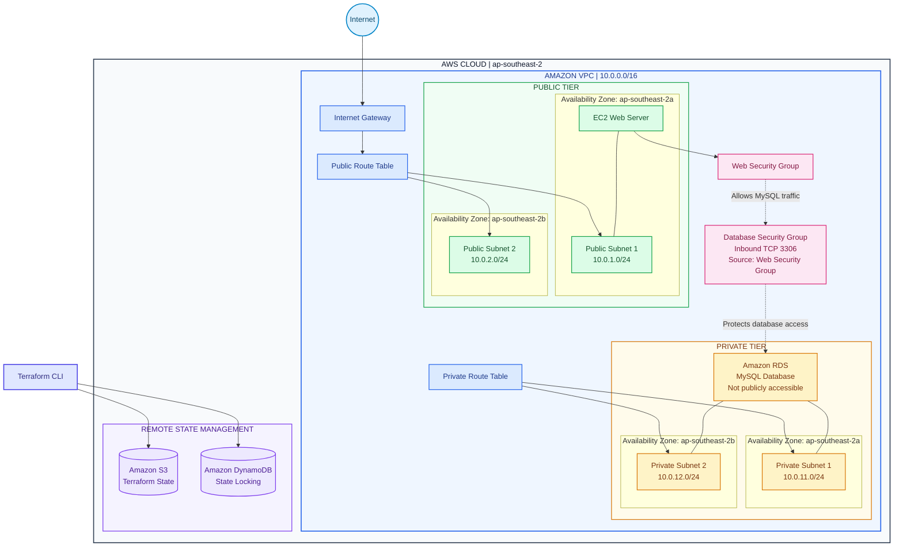

# terraform-aws-iac
# AWS Infrastructure as Code with Terraform

**Provisioning modular AWS infrastructure using Terraform, with remote state management and reusable modules.**

## Project Overview

This project demonstrates how to provision and manage AWS infrastructure using **Terraform**, following Infrastructure as Code (IaC) principles.

The infrastructure represents the foundation of a web application environment, with public and private networking, an EC2 compute instance, and a managed MySQL database.

Instead of manually creating resources through the AWS Management Console, the infrastructure is defined declaratively in Terraform, organised into reusable modules, and managed through version-controlled configuration.

## Architecture

The infrastructure consists of:

- A custom Amazon VPC.
- Two public subnets across separate Availability Zones.
- Two private subnets across separate Availability Zones.
- An Internet Gateway and public route table.
- A private route table for private subnet routing.
- An EC2 instance deployed in a public subnet.
- Security groups controlling access to the EC2 instance and RDS database.
- An Amazon RDS MySQL database deployed privately.
- An S3 remote backend with DynamoDB-based state locking.

### Architecture Diagram



*The diagram represents the intended architecture. The private route table currently provides private subnet routing; a NAT Gateway has not been configured.*

## AWS Services Used

| Service | Purpose |
|---|---|
| Amazon VPC | Isolated cloud network |
| Amazon EC2 | Compute instance for the web tier |
| Amazon RDS (MySQL) | Managed relational database |
| Amazon S3 | Terraform remote state storage |
| Amazon DynamoDB | Terraform state locking |
| AWS IAM | Identity and access management |
| Internet Gateway | Internet connectivity for public subnets |
| Security Groups | Network traffic control |

## Infrastructure Components

### 1. Networking

- Created a custom VPC with CIDR `10.0.0.0/16`.
- Created two public subnets across two Availability Zones.
- Created two private subnets across two Availability Zones.
- Configured an Internet Gateway.
- Created public and private route tables.
- Associated the route tables with their respective subnets.

### 2. Compute

- Provisioned an Amazon EC2 instance in a public subnet.
- Used an Amazon Linux 2023 AMI.
- Configured a web security group.
- Restricted administrative access using a configurable CIDR variable.

### 3. Database

- Provisioned an Amazon RDS MySQL instance.
- Created a dedicated DB subnet group using private subnets.
- Configured a database security group.
- Allowed MySQL traffic on port `3306` only from the EC2 web security group.
- Configured the database as non-publicly accessible.

### 4. Terraform State Management

- Configured an Amazon S3 backend for remote Terraform state.
- Configured DynamoDB-based state locking.
- Enabled state encryption.
- Created a local state backup before refactoring the infrastructure.

### 5. Modular Terraform Architecture

The Terraform configuration was refactored into reusable modules to improve maintainability and separation of concerns.

```text
terraform-aws-iac/
│
├── main.tf
├── variables.tf
├── outputs.tf
├── .gitignore
├── .terraform.lock.hcl
│
└── modules/
    ├── network/
    │   ├── main.tf
    │   ├── variables.tf
    │   └── outputs.tf
    │
    ├── compute/
    │   ├── main.tf
    │   ├── variables.tf
    │   └── outputs.tf
    │
    └── database/
        ├── main.tf
        ├── variables.tf
        └── outputs.tf
```

| Module | Responsibility |
|---|---|
| `network` | VPC, subnets, Internet Gateway and route tables |
| `compute` | EC2 instance and web security group |
| `database` | RDS MySQL, DB subnet group and database security group |

## Terraform Workflow

The infrastructure is managed using the following workflow:

```bash
# Initialise Terraform
terraform init

# Format configuration files
terraform fmt -recursive

# Validate configuration
terraform validate

# Preview infrastructure changes
terraform plan

# Apply infrastructure changes
terraform apply
```

To inspect the resources managed by Terraform:

```bash
terraform state list
```

## Key Learnings

Through this project, I gained practical experience with:

- Infrastructure as Code using Terraform and HCL.
- Provisioning AWS networking and compute resources.
- Designing public and private subnet architectures.
- Configuring security groups and resource-level access.
- Deploying and configuring Amazon RDS.
- Managing Terraform remote state using S3.
- Understanding Terraform state locking.
- Refactoring root-level resources into reusable modules.
- Migrating existing Terraform state into module-based resource addresses.
- Using `terraform plan` to detect infrastructure drift and avoid unintended changes.


## Cleanup

When the infrastructure is no longer required, it can be removed using:

```bash
terraform destroy
```

Review the destruction plan carefully before confirming. The S3 backend and DynamoDB lock table should be managed separately if they are shared or required to retain Terraform state.

---

**Author:** Khyati Saxena

**Technologies:** Terraform | AWS | HCL | Amazon VPC | EC2 | RDS | S3 | DynamoDB | IAM